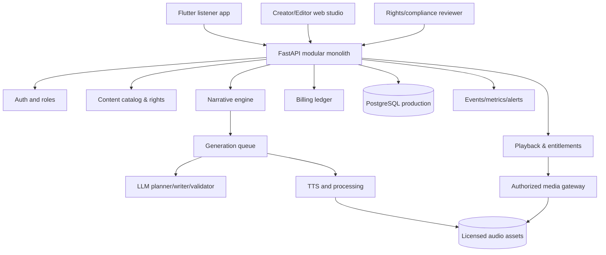

# AudioVerse architecture & decision boundaries

## Scope and C4 context
Users: Vietnamese listeners via mobile; creator/editor/reviewer via secure future web studio; operations via internal dashboards. External dependencies: app stores (IAP and review), lawful audio licensors, optional cloud LLM/TTS, storage/CDN, payment reconciliation and messaging provider. Never assume creators' Internet links grant recording/derivative/voice usage rights.

## Deployment profiles
**Local demo, IMPLEMENTED:** Python FastAPI, SQLite state/event tables, original JSON graph, synthetic MP3 files and browser/Flutter source. Bind `127.0.0.1`; fake header identity. No billing or remote inference. No secrets and no third-party content. Do NOT connect to public Internet as a server.

**Production target, NOT IMPLEMENTED:** Flutter Android/iOS with secure session; FastAPI modular monolith in an environment approved for Vietnam compliance; Postgres with migrations and tenant scoping; Redis/Valkey or durable queue; object storage for licensed media (R2 only if legal/locality review permits); authenticated short-lived delivery via edge or signed origin; KMS secrets, logs, managed backups, WAF/rate limits, AI provider quotas, service account separation, legal provenance workflow and app-store billing.

## Domains/modules (suggested Python package refactor)
- `identity`: login, devices, RBAC, consent, age/parental controls.
- `catalog`: works, editions, episodes, publishing windows, visible metadata.
- `rights`: grants, contracts, evidence, territory/time, takedown, voice permissions.
- `media`: transcode, checksum, private object keys, playback tokens, download policy.
- `narrative`: authored graph, runs, deterministic state, event log, AI drafting, eval.
- `entitlement`: purchases, store transactions, access rights, quota and usage ledger.
- `creator`: onboarding, editorial review, distribution performance, royalty payouts.
- `platform`: experimentation, analytics, abuse moderation, incidents.

## Cross-module invariants
1. `rights.can(action, asset, user, time, territory)` is checked at **publish**, **render job**, and **delivery**, never only on client.
2. `narrative.commit(state_transition)` is deterministic and transactional; LLM cannot write directly to canonical tables.
3. All state mutations have actor, command_id, time, expected_version, audit context. Choice events are append-only.
4. Billing grants come from verified server-to-store or authorized enterprise contracts; client claims do not grant access.
5. Render jobs are idempotent and bounded in cost. Cache keys include **text digest, rights version, voice, model, synthesis settings**.
6. An authored edition can change, but existing runs are pinned to a specific edition version; migrations must be explicit.
7. Asset references are opaque identifiers; never expose raw private storage keys or unrestricted bucket listing.

## Data flows
### Fixed licensed audio
Creator rights evidence -> reviewer -> ingest quarantine -> scan/normalization -> audio quality gate -> publish approved asset -> login/entitlement check -> short-lived media authorization -> CDN/R2 range/HLS -> local position -> account progress.

### Interactive AI
User chooses -> API auth+rights+quota+run version -> deterministic transition -> event log -> pre-rendered segment lookup -> if absent enqueue bounded generation -> LLM draft (structured) -> validator & moderation -> TTS render -> private cache -> authorized delivery -> user hears -> telemetry. Production must resolve the atomicity question: whether a run commits at choice acceptance or after usable audio is produced. Recommended: commit choice event immediately; maintain distinct `render_status` with fallback, never silently roll back already confirmed user choice.

### Human audio to interactive adaptation
Grant for original stream does NOT imply derivative right. Keep editions as different assets. If an adaptation is authorized, connect the original recording to a *specifically authorized script edition*, map excerpts to story scenes only within granted scope; AI-generated transitions use licensed voice and script rights separately. Do not algorithmically splice unauthorized human performances into derivative scenes.

## Non-functional SLO targets (not achieved)
- API p95 <300ms for metadata/choice validation, excluding AI rendering.
- Content playback start p95 <3s on representative Vietnam cellular network.
- Interactive pre-render branch start p95 <3s; on-demand first-audio latency measured per provider, initial threshold to be set from real beta.
- 99.9% monthly availability target after production readiness, not a current promise.
- Zero known unauthorized data access/rights bypass; audited restore drills with RPO/RTO defined before beta.
- All paid actions idempotent; no duplicate charge on request retries.

## Architectural decision log
See ADR-001 to ADR-006. The architecture is not frozen: tasks may change it through explicit ADR and compatibility migration.
