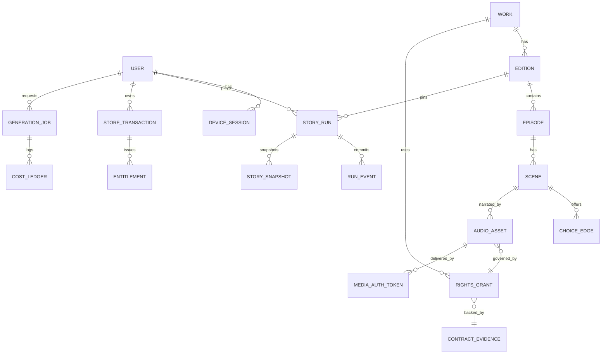

# Data and state architecture

## Demo database (implemented)
SQLite file path configured by `AUDIOVERSE_DB_PATH`; created on app startup; tables:
- `runs(id PK, story_id, demo_actor, scene_id, flags_json, version, created_at, updated_at)`
- `events(id PK, run_id FK, idem_key, from_scene, to_scene, choice_id, response_json, created_at)` with `UNIQUE(run_id, idem_key)`.
The story graph and license manifest are local JSON files, not database rows. Data durability is **dev-only**. DB has no user authentication, business continuity, migration history, full audit of content decisions or production concurrency support.

## Target relational model (not implemented)

## Core entities and required fields
- `works`: immutable work_id; source language; primary author; content risk tags; publication status; title/synopsis.
- `editions`: id, work_id, graph schema version, rights grant refs, release status, immutable content hash, default passive route.
- `episodes/scenes`: ordered position, text and audio refs, word/character counts, authored beat IDs, choice types, age classification, content approval state.
- `choice_edges`: source, target, requirements, deterministic state effects, allowed actor intents, ordering, editorial review.
- `story_runs`: user, edition version, current scene, run version, state checksum, created/last action.
- `run_events`: idempotency key, expected version, transition, fact delta, canonical time, user/AI action type, cost ledger pointer; append only.
- `story_snapshots`: run version, canonical serialized state, checksum and replay metadata.
- `rights_grants`: content work/edition/voice/recording id, holder, exact granted actions, territory, term, revocation, contract evidence, reviewer decision and version.
- `audio_assets`: opaque object key, SHA-256 checksum, duration, codec, model/provider, voice/consent reference, transcript, allowed actions, rights version, publishing state.
- `users`: minimal contact/consent/age information required; encrypt/mask sensitive values.
- `store_transactions`: store provider, opaque transaction id, original transaction id, signed payload reference, verified_at, expiry/reversal.
- `entitlements`: user, work/plan, expiry, purchase source and immutable ledger.
- `generation_jobs`: run/scene/rights version, idempotency, provider, status, deadline, budget limit, retries, audio artifact id.
- `cost_ledger`: actual billable tokens, characters, GPU seconds, provider pricing-version id, USD/VND estimate, settled cost.
- `creator_contracts/royalty_payouts`: agreement version, net-revenue definitions, statements, approval chain, payment audit.

## Recommended indexes / constraints
- `UNIQUE(run_id, idempotency_key)`; `UNIQUE(provider, store_transaction_id)`; `UNIQUE(edition_id, scene_id)`; `UNIQUE(audio_checksum, voice_config, license_version)` only within privacy-safe cache scope.
- FK all playback to edition, not only work, to preserve old runs.
- Story event monotonic per-run version; optimistic concurrency transaction.
- RLS/tenant scoping and all object media authorization; no shared user-provided text/audio cache without explicit policy.
- Rights grant cannot self-approve; maker/checker separate reviewer roles; expiration/territory checked at use time.

## Event sourcing vs DB snapshots
Events are append-only source of run transitions; snapshots are optimization. To restore: load most recent verified snapshot, replay subsequent events with deterministic engine, verify hash. LLM outputs are stored as immutable **drafts**, never authoritative facts. This simplifies model upgrades and debugging.

## Migration plan
T003: SQLAlchemy 2 + Alembic migrations; production PostgreSQL (managed or self-host with backups), separate dev/stage/prod databases, reversible migrations and migration test on a copy of fixture data. Do not migrate live SQLite users automatically without an audited mapping; demo has no real users.
